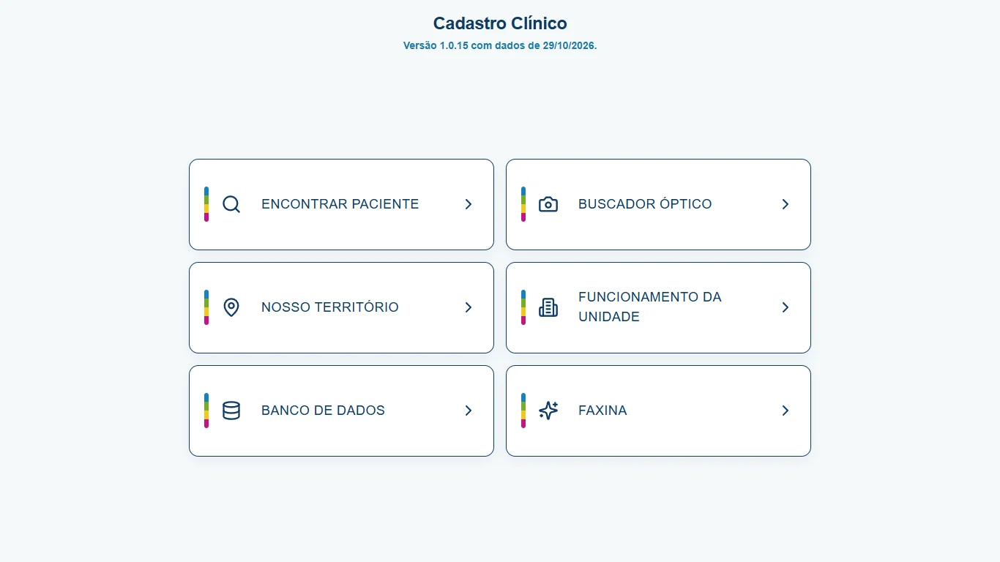

# Cadastro Clínico

Organizador **offline** de fichas, território e rotina da unidade para profissionais de saúde.
Reúne busca de pacientes, ruas e equipes, funcionamento da unidade, importação em lote e
conferência de qualidade em um só aplicativo — **sem conta, sem nuvem e sem enviar cadastros
para servidor**.

[](https://wavizo-bot.github.io/CadastroClinico/)

*Captura real do aplicativo com dados fictícios. Nenhum dado de paciente real foi usado.*

**Versão atual: 1.0.15** (Android `versionCode 19` · Windows `1.0.15.0`)

---

## O que é

O Cadastro Clínico é um **espelho de trabalho**: ele organiza a base que você já produz em
outro lugar e oferece consulta rápida no dia a dia. Não é a fonte original dos dados, não é
prontuário oficial e não substitui sistemas institucionais ou a decisão de um profissional
habilitado.

Serve para profissionais autônomos, equipes de recepção e apoio administrativo que precisam
achar uma ficha, conferir a equipe responsável por um endereço ou consultar o funcionamento
da unidade sem depender de planilhas espalhadas.

## Recursos principais

- **Busca de fichas** por nome, CNS, CPF, telefone ou endereço, com paginação e histórico.
- **Ficha completa** com nome da mãe, nascimento e idade, cadastro, endereço, documentos e
  telefones; o WhatsApp abre no aplicativo externo.
- **Território por rua**: faixas de numeração, números pares/ímpares, listas específicas e
  desempate pela regra mais específica. A inicial da ficha recebe a cor da equipe.
- **Funcionamento da unidade** em setores organizados (horários, exames, farmácia, vacinação
  e outros fluxos).
- **Importação em lote** de CSV, TSV, TXT, RAR e ZIP, com união de relatórios e detecção de
  equipes.
- **Importar da URL** (opcional): baixa um arquivo `.rar`, `.zip` ou `.csv` de um link HTTPS
  indicado por você. É a única função que usa internet, além de abrir links de WhatsApp.
- **Faxina de qualidade**: valida CPF e CNS, procura duplicidades, nomes parecidos e
  inversões. É somente leitura — aponta para revisão e não altera o banco.
- **Exportação manual em JSON** para guardar onde quiser.
- **Senha opcional de 4 caracteres** para discrição; não substitui o bloqueio de tela nem a
  criptografia do sistema.
- **Android, Windows e web** com a mesma base de consulta em cada instalação.

## Privacidade e armazenamento

- **Local por padrão.** As fichas ficam no armazenamento do aparelho ou do navegador
  (IndexedDB), cifradas com **AES-GCM** e uma chave aleatória gerada no próprio dispositivo.
- **Sem conta, servidor, nuvem, analytics ou SDK de anúncios.** Nada é vendido ou
  compartilhado.
- **Sem sincronização automática** entre celular, computador e web. Cada instalação tem o
  próprio banco; o backup é manual (JSON).
- **Internet apenas** no recurso opcional “Importar da URL” e ao abrir um link de WhatsApp.
- **Sem Google Drive, OAuth ou APIs do Google.** O “Limited Use” do Google não se aplica.
- **Direitos LGPD/GDPR** são exercidos no próprio app: consulte, corrija, exporte ou apague as
  fichas; para apagar tudo, use “Reiniciar” no Banco de dados ou limpe os dados do aplicativo.
- Se a chave local se perder, o banco não é recuperável pelo app: reimporte da fonte oficial.

Leia a [Política de Privacidade](https://wavizo-bot.github.io/CadastroClinico/politica-privacidade.html)
para o detalhamento.

## Requisitos

| Plataforma | Requisitos |
| --- | --- |
| Android | Android 7.0 (API 24) ou superior; instalação pela Google Play |
| Windows | Windows 10/11 64 bits + WebView2 Runtime; pacote MSIX |
| Web | Chrome, Edge, Firefox ou Safari recentes; armazenamento local por origem |
| Desenvolvimento | Node.js 20+, pnpm 10, JDK 21 + Android SDK (Android), .NET 8 SDK + Windows SDK (MSIX) |

Limitações importantes: não há sincronização entre aparelhos; o backup é manual; a interface
é responsiva a partir de 360 px; não há versão para iOS neste pacote.

## Desenvolvimento

```bash
pnpm install
pnpm dev          # servidor de desenvolvimento
pnpm check        # TypeScript (tsc --noEmit)
pnpm exec vitest run
```

O app web fica em `client/`. O servidor Express em `server/` apenas serve os estáticos e o
fallback da SPA; não há API de dados.

## Build e empacotamento

**Web / PWA**

```bash
pnpm run build
```

Gera `dist/public/` (build usado pelo Capacitor e pelo servidor estático).

**Android (AAB + APK)**

```bash
pnpm run build
npx cap sync android
cd android
./gradlew.bat bundleRelease assembleRelease
```

O AAB sai em `android/app/build/outputs/bundle/release/`. A assinatura usa
`android/keystore.properties` (não versionado) ou as variáveis `CADCLINICO_STORE_FILE`,
`CADCLINICO_STORE_PASSWORD`, `CADCLINICO_KEY_ALIAS` e `CADCLINICO_KEY_PASSWORD`.

**Windows (MSIX)**

```powershell
.\msix\build.ps1
```

O script roda o build web, publica o wrapper C#/WebView2 autocontido, empacota com
`makeappx` e valida o `.msix` em `msix/dist/`.

**GitHub Pages**

```bash
node scripts/build-pages.mjs
```

Gera `docs/app/` com base `/CadastroClinico/app/`, sem alterar o build Android (base `/`).
A landing e os documentos legais ficam na raiz de `docs/`.

## Estrutura de pastas

```text
client/                 App React + Vite (fonte e build web)
  src/pages/            Home (telas de campo) e Admin (importação/exportação)
  src/lib/              dataStore, importação, território, busca e Faxina
  public/               Documentos legais, favicon, OCR e service worker
server/                 Express estático com fallback da SPA
shared/                 Tipos e constantes compartilhadas
android/                Projeto Capacitor Android (AAB/APK)
msix/                   Wrapper C#/WebView2 e build do pacote Windows
docs/                   Landing, documentos legais e build do Pages (docs/app/)
scripts/                Build do Pages e ofuscação dos bundles
entregas/               Artefatos locais de entrega (ignorado pelo git)
```

## Links

- **Landing:** https://wavizo-bot.github.io/CadastroClinico/
- **Versão web:** https://wavizo-bot.github.io/CadastroClinico/app/
- **Microsoft Store:** https://apps.microsoft.com/detail/9P88RMK5TDSB
- **Política de Privacidade:** https://wavizo-bot.github.io/CadastroClinico/politica-privacidade.html
- **Termos de Serviço:** https://wavizo-bot.github.io/CadastroClinico/termos-de-servico.html
- **Aviso Legal:** https://wavizo-bot.github.io/CadastroClinico/aviso-legal.html
- **Repositório:** https://github.com/wavizo-bot/CadastroClinico
- **Android:** pacote AAB v19 preparado para o Google Play; a URL pública será adicionada
  quando a publicação for aprovada.

## Contato

- E-mail: **mmr05@hotmail.com**
- Telefone / WhatsApp: **(11) 97883-1938**

Projeto independente, sem vínculo com governo, prefeitura, estado, SUS, ministério, autarquia
ou conselho profissional. Não é prontuário eletrônico, dispositivo médico ou registro legal
obrigatório.

---

## English summary

Cadastro Clínico is an offline-first organizer for patient records, street-based territory and
unit routines. Data stays encrypted on the device (AES-GCM); there is no account, cloud sync,
advertising or analytics. The optional URL import only downloads a file the user chooses, and
WhatsApp links open the external app. It is an independent tool — not an official government
system, medical record or medical device — and it does not replace the judgement of a qualified
professional. Available for Android, Windows and the web, with manual JSON export for backup.

Version 1.0.15. Contact: mmr05@hotmail.com · +55 11 97883-1938.
